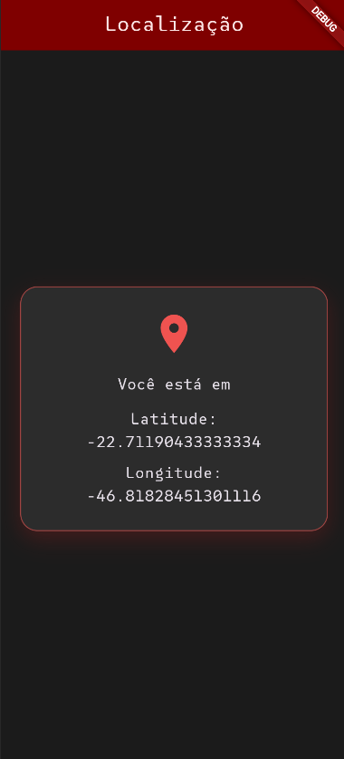

# Flutter GPS

Aplicativo Flutter para obter a localização atual do dispositivo usando o pacote `geolocator`. A interface exibe a latitude e a longitude em tempo real, com uma paleta visual em vermelho e a fonte `SUSEMono`.

## Screenshot



## APK

[Flutter GPS](./flutter_gps/assets/flutter_gps.apk)

## Funcionalidades

- Verifica se o serviço de localização está ativado
- Solicita permissão de localização quando necessário
- Obtém a latitude e a longitude atual do dispositivo
- Exibe os dados em uma interface simples e moderna

## Estrutura do projeto

```text
Flutter-Gps/
├── README.md
├── flutter_gps/
│   ├── lib/
│   ├── assets/
│   ├── android/
│   ├── ios/
│   ├── pubspec.yaml
│   └── ...
└──
```

## Pré-requisitos

- [Flutter SDK](https://docs.flutter.dev/get-started/install)
- Android Studio
- IDE (EX.: VsCode)
- Emulador ou dispositivo físico conectado

## Como executar

1. Clone o repositório:

   ```bash
   git clone https://github.com/EnzoToniato567/Flutter-Gps.git
   ```

2. Acesse a pasta da aplicação:

   ```bash
   cd Flutter-Gps/flutter_gps
   ```

3. Instale as dependências:

   ```bash
   flutter pub get
   ```

4. Execute o app:

   ```bash
   flutter run
   ```

## Dependências principais

- `flutter`
- `geolocator: ^14.1.1`

## Observações

Este projeto foi criado para demonstrar o uso da API de localização do Flutter e a captura de coordenadas do usuário. A permissão de localização do dispositivo precisa ser concedida para que a leitura funcione corretamente.
